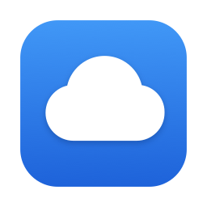

<p align="center">
  
</p>

<h1 align="center">CloudAccess</h1>

<p align="center">
  Your own storage, as a drive on your Mac.<br>
  With <b>CloudWanderer</b>, the same files on your iPhone.
</p>

> **Attention: in development.** Don't keep the only copy of anything on it yet.

## What is it?

You may already pay for storage somewhere: a storage box from a hosting company, a storage device at home (often called a NAS), or space on a web server. Usually, getting files in and out of it means a separate program, copying files back and forth, and remembering which copy is the latest.

**CloudAccess makes that storage look like an ordinary drive on your Mac.** It appears in Finder's sidebar, just like iCloud Drive or Dropbox. You open, save, rename and drag files as you always do, and they're kept on your storage.

- **It doesn't fill your Mac.** Files stay on your storage and download only when you open them. Copies you haven't used for a while are removed from the Mac, and stay on the storage.
- **You choose what stays.** Mark a folder to stay downloaded, and it's always there, even without internet.
- **It can lock your files.** Switch on encryption, and files are scrambled on your Mac before they leave it. Whoever runs the storage sees only unreadable data, not your files or their names.
- **It doesn't lose your work.** A save your Mac has confirmed is kept. If two computers change the same file at the same time, both versions are kept. Deleted files wait in a trash on the storage, for a week unless you choose otherwise. That's Safe mode, the standard one: see [Drive modes](#drive-modes).
- **Your drives move with you.** One encrypted file carries your drives and their passwords to another Mac or an iPhone, by AirDrop.
- **Nothing locks you in.** Files are stored in standard formats, so you can always reach them with other tools, even without this app.

**CloudWanderer** is the iPhone companion. It shows your drives so you can browse files, download them, and share them to other apps. Plain drives also appear in the iPhone's Files app. You set it up by scanning a code on your Mac, so you only type the passwords.

Both apps are in English and Spanish.

### What you need

- A Mac with macOS 26 or later. CloudWanderer needs iOS 26 or later.
- Storage you can reach over **WebDAV** or **SFTP**. These are two common ways for apps to connect to storage. Your provider or device tells you which it offers, along with an address, a username and a password.

So far it's been tested with a Hetzner Storage Box and with servers set up for testing. Any other storage has to pass the same safety checks. If it can't be saved to safely, the drive opens read-only instead.

There's no download yet. For now, it has to be built from source: see [For developers](#for-developers).

## Getting started

### On your Mac

1. Click the CloudAccess icon in the menu bar, then choose Settings, then Add Drive.
2. Enter your storage's address, username and password. Switch on **Enable encryption** if you want it. This choice can't be changed later.
3. Turn CloudAccess on under System Settings, General, Login Items & Extensions. The CloudAccess menu has a shortcut there.
4. Your drive appears in Finder's sidebar.

In a drive's details you choose how long downloaded copies stay, how much space they may use, and which folders always stay downloaded.

### On your iPhone

1. On your Mac, open the drive's details and choose Show QR Code.
2. In CloudWanderer, add a drive, scan the code, and type the passwords.

To change a drive later, swipe it and choose Edit. To bring several drives at once, passwords included, use a drives file.

### Moving drives to another Mac or iPhone

1. **Export:** on the Mac, open Settings and choose Export… beside Export drives. CloudWanderer has the same in its Drives file section. The device first asks for Touch ID, Face ID or its password.
2. **Choose and seal:** pick the drives to include. The file is sealed with a password of its own: use the one offered, or your own of at least 12 characters.
3. **Send it:** with AirDrop, or save it.
4. **Import:**
   - On another Mac, choose Import… beside Import drives in Settings.
   - On an iPhone, open the file from AirDrop in CloudWanderer.
5. **Enter the file's password,** then choose what happens to each drive: add it, update the passwords of one already there, or skip it.

**Attention: the file and its password together open every drive in it.** Keep them apart.

- **You choose every step.** Every drive starts on Skip, so nothing changes unless you choose it.
- **Nothing is half-done or removed.** Each drive's step either finishes or changes nothing, and an import never removes a drive.
- **The file holds no ID or consent.** Each device gives its drives new IDs, and asks again before sending a password over plain http.

### Drive modes

SFTP drives have three modes, under Advanced in a drive's details. You can switch at any time.

| Mode | What it does | What it gives up |
|---|---|---|
| **Safe** (standard) | Everything above: no save overwrites another computer's, both versions kept on a conflict, deleted files kept in a trash. | Keeps a `.cloudmount` folder on the server for this. |
| **Unsafe** | Nothing on the server but your files. Saves still check they're replacing the version you started from, keep both versions on a conflict, and land in one step. | **Attention:** deleted files and replaced versions are gone for good, and two computers saving the same file at the same moment can lose one save. |
| **Read-only** | Writes nothing. | Changes can't be made. |

- **Removing the folder:** when you switch to Unsafe or Read-only, the app offers to remove the `.cloudmount` folder, and says what it holds first. On an encrypted drive, its `vault` folder stays, because the drive can't be opened without it.
- **Other computers:** one still in Safe mode makes the folder again.
- **WebDAV drives** have Safe and Read-only only, because WebDAV servers can't replace a file in one step.

### Language

The apps follow your device's language, English or Spanish. To choose one yourself, use Language in Settings on the Mac, or in About on the iPhone. The change shows after the app restarts.

### Uninstalling

Deleting an app gives it no chance to clean up, so do this first. Choose Uninstall… in About, on the Mac or the iPhone. The window lists what will go, then shows each step and what its check found.

1. **On the Mac, it waits for uploads.** It goes on by itself once nothing is left to send, and you can cancel until then.
2. **It removes each drive** the same way as its own Remove button. On the Mac, files that hadn't uploaded are kept, and the last page shows where.
3. **It deletes what the app keeps on the device:** the drive list, each drive's database, cached downloads, the log and the settings. Then it deletes every saved password.
4. **It checks again for anything left:** locations in Finder or Files, drives, passwords and files. A step passes only when its check finds nothing. If one fails, the window says what's left and what that means, and Try Again carries on from there.
5. **Then delete the app:**
   - On the Mac, Quit also turns off launch at login. Then move CloudAccess to the Bin.
   - On the iPhone, touch and hold its icon, then choose Remove App.

**Attention:** without its password, an encrypted drive can't be read. Export your drives, or save each recovery kit, before you uninstall.

- **Your servers are not changed.** The files, `.cloudmount` and each encrypted drive's marker stay, so installing again finds everything where it was.
- **Save Report…** keeps a record of each step, because the log is deleted with the rest. It names drives, never servers or passwords.
- **macOS keeps each app's own folder** in `~/Library/Containers`, with nothing of your drives in it. An app can't delete its own.

### Something not working?

On the iPhone, About has the app's log: Show Log reads it, and Share Log sends it to your Mac with AirDrop. The log says what happened to each drive. It never holds file names or passwords.

## Good to know

- **WebDAV and SFTP only.**
- **Changes made elsewhere aren't instant.** The Mac checks the storage every minute for folders you've used recently, and every 30 minutes for the rest.
- **The app has to be running** for changes made elsewhere to reach Finder. It starts by itself when you log in.
- **Some Mac extras stay on the Mac.** Finder tags and symbolic links aren't copied to the storage, and neither is some hidden information macOS attaches to files.
- **File dates:** a file keeps its own dates on SFTP, and on WebDAV storage that can store them, such as the Storage Box. Files put on the storage by other programs show when they arrived there.
- **Replaced versions are kept for a week,** and only up to 2 GB on WebDAV.
- **Git repositories and databases,** such as SQLite files, are only safe when used from one computer at a time.
- **The iPhone only reads.** CloudWanderer and the Files app never change anything on your storage. A download stops if you leave the app.
- **Encrypted drives don't appear in the iPhone's Files app,** only in CloudWanderer. Unlocking one needs more memory than iOS allows there.
- **The Files app** picks up changes while you're using it, and whenever you open CloudWanderer. Nothing checks in the background, because this kind of storage can't wake an iPhone.
- **iPhone passwords stay on that iPhone** and aren't in its backups, unless you export them into a drives file. A new or restored iPhone asks for them again.

### Trade-offs, chosen on purpose

- **Folder layout is visible to the storage.** On encrypted drives, names and contents are hidden, but the storage can still see how many folders there are and how they nest.
- **One password per encrypted drive,** shared by hand. There's no access per person, and the password can't be changed in place: moving to a new one means a new drive.
- **Each save takes about ten small requests.** That's the price of never overwriting someone else's save, on storage that can't do it in one step.
- **After a crash in the middle of a save,** that one file can be blocked for up to 10 minutes.
- **Other programs aren't protected.** If another program writes to the same storage, it can overwrite a save. Use other programs only for reading and recovery.
- **A computer frozen for over 10 minutes at exactly the wrong moment could overwrite another's save.** Neither WebDAV nor SFTP can rule this out.

## Privacy

- **No tracking or analytics.** The apps only connect to your own storage.
- **Passwords stay in your device's keychain.** They're never put in a QR code, a log or a settings file. The only way they leave it is a drives file you make yourself, sealed with its own password.
- **Logs leave your device only when you share them.**

## Your files without this app

Everything CloudAccess stores can be read with [rclone](https://rclone.org), a widely used command-line tool, on any computer. Use it if the app stops working, your Mac is gone, or you're moving away. Use rclone to get files out, not alongside CloudAccess: it doesn't take part in the locks that keep two computers from overwriting each other.

**Plain drives** are ordinary files on the storage, readable with any WebDAV or SFTP program. Ignore the `.cloudmount` folder: it holds uploads in progress and deleted files. A drive in Unsafe or Read-only mode may have none, and an Unsafe upload in progress is a hidden file named `.cm-…part` in the drive's top folder. Mac documents that are really folders, such as some `.numbers` files, are stored as one file ending in `.pkgf`, which only a Mac with CloudAccess turns back into the document.

**Encrypted drives** need the encryption password, which nobody else has, and the salt, which is in the recovery kit the app offers you. Save that kit. Without the password, the files can't be recovered.

<details>
<summary>Step by step: reading an encrypted drive with rclone</summary>

1. Install rclone from [rclone.org/downloads](https://rclone.org/downloads/).
2. Obscure both values, once each:

   ```sh
   rclone obscure 'your encryption password'
   rclone obscure 'your salt'
   ```

   If you have no recovery kit, the salt is in the `salt` field of the highest-numbered file in `.cloudmount/vault/` on the storage. It isn't secret.
3. Run `rclone config file` to find rclone's settings file, and add your storage to it. For WebDAV:

   ```ini
   [my-server]
   type = webdav
   url = https://example.com/
   vendor = other
   user = your-username
   pass = <output of: rclone obscure 'your server password'>
   ```

   For SFTP:

   ```ini
   [my-server]
   type = sftp
   host = example.com
   port = 22
   user = your-username
   pass = <output of: rclone obscure 'your server password'>
   ```

4. Below it, add the encrypted drive. `remote` is your storage's name, then the drive's folder:

   ```ini
   [cloudaccess-recovery]
   type = crypt
   remote = my-server:the-drive-folder
   filename_encryption = standard
   directory_name_encryption = true
   filename_encoding = base32
   password = <obscured encryption password>
   password2 = <obscured salt>
   ```

5. Copy your files out:

   ```sh
   rclone lsf cloudaccess-recovery:
   rclone copy cloudaccess-recovery: ~/Recovered --progress
   ```

A kit from before the app was renamed names its section `[cloudmount-recovery]`. Use that name in the commands. rclone prints a notice about `.cloudmount`, because that folder's names aren't encrypted. It's harmless. If `lsf` shows nothing, the password or the salt is wrong: rclone shows an empty folder instead of an error.

</details>

## For developers

### How it works

CloudAccess is a menu bar app with a File Provider extension, the system iCloud Drive uses. macOS mounts each drive under `~/Library/CloudStorage` and asks the extension for listings and contents when they're needed. Transfers go through a Go engine built on rclone, so encrypted drives use rclone's crypt format unchanged.

```
Finder ── File Provider extension ── MountKit ── SyncCore ── Go engine ── your server
                                                              (rclone)
Menu bar app: settings, status, and checking the server for changes
```

Neither WebDAV nor SFTP can replace a file only if nobody else has changed it, so every save:

1. uploads to a staging area on the server;
2. takes a short claim on the file, by creating a folder, which both protocols do atomically;
3. checks that the file is still the version the edit started from;
4. copies the old version to the trash and moves the new one into place;
5. releases the claim.

If another device saved first, the new file is kept as a conflict copy instead.

That's Safe mode. In Unsafe mode, on SFTP only, a save uploads to a hidden file in the drive's top folder, checks the version, and replaces the file with one rename, which SFTP does in one step. There's no claim and no trash, and nothing is written under `.cloudmount`.

CloudWanderer uses the same engine directly to browse and download. Its read-only Files extension runs the engine in a lean mode, because iOS stops these extensions at about 20 MB of memory.

### Building

You need Xcode 27 and Go 1.26 or later. rclone is optional: the tests that check plain rclone can read a drive use it when it's installed.

```sh
bash Engine/build.sh all     # builds the engine for macOS, iOS and the simulator
open CloudAccess/CloudAccess.xcodeproj
open CloudWanderer/CloudWanderer.xcodeproj
```

Run the tests with:

```sh
go -C Engine test ./...
bash Scripts/swift-test.sh     # the Swift tests, in English whatever the Mac's language
```

The Swift tests link the built engine, so build it again after changing anything in `Engine/`.

**Debug builds only connect to a server folder named `cloudmount-test`,** so a test build can't touch real files.

**Signing uses the developer's own identifiers.** To run a build on your devices, sign with your own team, and replace `com.infinitecontext` and the App Group names with yours. They're in the projects, the entitlements and a few source files.

### Layout

| Folder | What's there |
|---|---|
| `Engine/` | Go engine: rclone, the save protocol, and the C interface |
| `Packages/CloudCore/` | Swift package shared by both apps: drives and settings, the engine wrapper, sync state, every decision about what macOS is told, and the shared look |
| `CloudAccess/` | The Mac app and its File Provider extension |
| `CloudWanderer/` | The iPhone app and its read-only Files extension |

## Licence

Apache 2 licensed software. See [LICENSE.md](LICENSE.md) and [NOTICE](NOTICE).

Developed by InfiniteContext.com.
